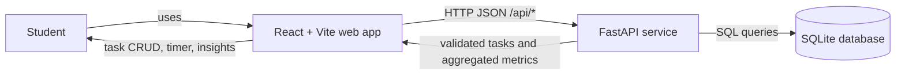

# StudyFlow

**A study planner that turns upcoming deadlines into a realistic weekly plan.**

StudyFlow helps a student see what is due, how much estimated work remains, and which task to start next. A focus timer records completed study blocks separately from estimates, so progress insights distinguish planned effort from time actually spent.

> Portfolio project built with React, React Three Fiber (three.js), ShaderGradient, FastAPI, SQLite, and Docker Compose. The 3D layers are lazy-loaded with CSS fallbacks. Ready for a tester deployment: each browser gets a private workspace, with no accounts. See [DEPLOY.md](DEPLOY.md).

## The story

Students often have assignments spread across subjects and deadlines, but a task list alone does not show whether the week is manageable. StudyFlow brings each task's subject, due date, and estimated effort together, then turns those details into a short-horizon workload view. A focus timer makes actual study time visible without treating an estimate as completed work.

## What you can do

- Add, edit, complete, filter, and delete study tasks.
- See today's plan, overdue work, near-term deadlines, and the next seven days.
- Start a focus timer for a task and save a completed session.
- Review weekly recorded focus time and completed sessions, separately from estimated remaining work.
- Use the responsive interface on desktop or mobile, with light and dark themes.
- Keep a timetable: weekly classes, tests and academic-calendar dates, added by hand or imported from an `.ics` calendar export (Google Calendar, Outlook, most university timetables).
- Get study sessions planned automatically on the days before each test.
- Get reminders while StudyFlow is open: before classes and events, the evening before and morning of a test, short and long breaks after focus blocks, and a bedtime nudge. Desktop notifications are optional.
- See the next class or test, with a live countdown, above the Now panel.
- Update the plan by typing to the assistant, e.g. `test Statistics on Friday 2pm`, `my stats exam is on the 28th` or `move SQL practice to Monday`. Type `undo`, or tap Undo, to reverse the last change.
- Get a morning summary of today's classes, tests and what's due.
- Load a fresh sample week from the profile menu, so the demo always opens on current dates.

## Architecture



The frontend owns interaction and presentation. FastAPI validates requests and exposes task, session, insight, and health endpoints. SQLite stores tasks and completed focus sessions. The focus timer submits a session only when it reaches completion; a unique session key makes a retry safe from duplicate recording. Insights combine task state with recorded sessions while keeping estimated workload and actual focus time as different measures.

## Run it locally

### Docker Compose

Install Docker Desktop, then run this from the project folder:

```bash
docker compose up --build
```

Open [http://localhost:5173](http://localhost:5173). The API's interactive documentation is at [http://localhost:8000/docs](http://localhost:8000/docs). A few sample tasks are created on first run. Compose stores data in the `study_data` volume.

Stop the foreground services with `Ctrl+C`, then run:

```bash
docker compose down
```

If the web app is already running but its API does not yet expose `/api/sessions` or the weekly focus metrics, rebuild and restart only the API:

```bash
docker compose up --build -d api
```

This updates the API container and keeps the Compose database volume.

### Run without Docker

In one terminal:

```bash
cd backend
python -m venv .venv
# Activate the virtual environment, then:
pip install -r requirements.txt
uvicorn app.main:app --reload
```

In a second terminal:

```bash
cd frontend
npm ci
npm run dev
```

## API overview

| Method | Endpoint | Purpose |
|---|---|---|
| `GET` | `/api/tasks` | List study tasks |
| `POST` | `/api/tasks` | Create a task |
| `PUT` | `/api/tasks/{id}` | Update task details |
| `PATCH` | `/api/tasks/{id}/complete` | Toggle task completion |
| `DELETE` | `/api/tasks/{id}` | Delete a task |
| `POST` | `/api/sessions` | Record a completed focus session idempotently |
| `GET` | `/api/insights` | Return workload, completion, subject, deadline, and focus summaries |
| `GET` | `/api/events` | List classes, tests and calendar events |
| `POST` | `/api/events` | Add a class (weekly), test or event; a test gets study sessions planned before it |
| `PUT` | `/api/events/{id}` | Edit a class, test or event; a moved test gets its study sessions re-planned |
| `DELETE` | `/api/events/{id}` | Remove a class, test or event (and a test's unfinished study sessions) |
| `POST` | `/api/events/import` | Import an iCalendar (.ics) export: weekly classes, tests, events |
| `GET` | `/api/agenda?days=7` | Dated agenda for the next N days (weekly classes expanded) |
| `POST` | `/api/assistant` | Plain-text commands that update the plan (rule-based, no AI service); `undo` reverses the last change |
| `POST` | `/api/demo/reset` | Replace all data with a sample week dated relative to today |
| `GET` | `/api/health` | Check API availability |

## Security boundary

The app has no login or per-user authorization. Compose binds its ports to localhost and the API container runs as a non-root user, but those controls do not make this a public service. Keep it on localhost and use sample data. A public deployment would need authentication and per-user authorization, HTTPS, request limits, and production security headers. See [REVIEW.md](./REVIEW.md) for the design, accessibility, security, and verification review.

## Implementation and verification

- React frontend built with Vite; Python API built with FastAPI; SQLite persistence.
- Docker Compose development setup and GitHub Actions build workflow.
- The production frontend build completed successfully, and the backend module passed a Python syntax parse.
- A full timer-length session and live persistence through a rebuilt API were not exercised in the latest focus-session iteration. Review the verification notes in [REVIEW.md](./REVIEW.md) for the full scope and limitations.

## How to present it

Describe the work in terms of the decisions you can explain: how task estimates feed the upcoming workload, why recorded focus time is stored separately, how session retries avoid duplicate records, and how the single-user security boundary shaped the local-only setup. Do not claim user research, deployment, or impact metrics that have not been measured.

For a short walkthrough, use [the portfolio demo guide](./docs/PORTFOLIO_DEMO.md).
