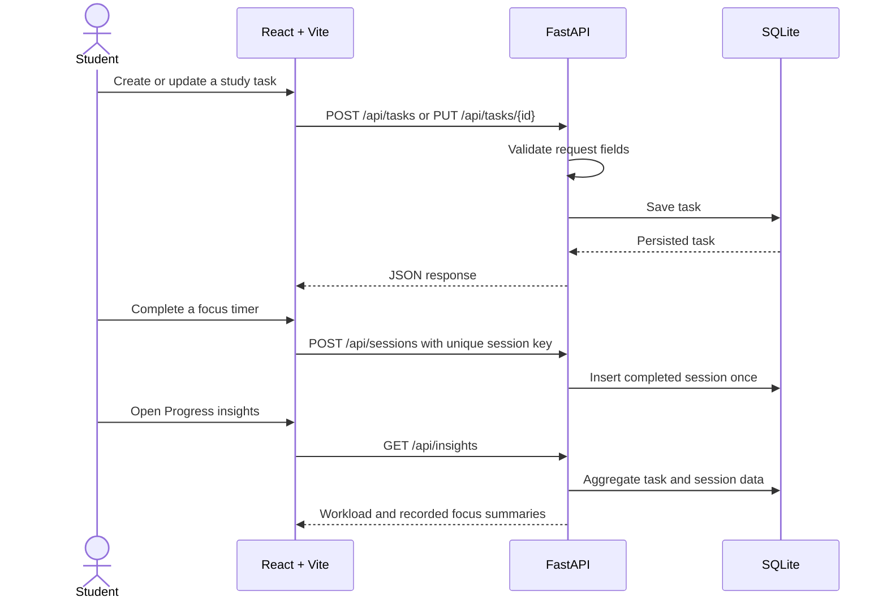

# StudyFlow portfolio demo

Use this as a two-to-three-minute walkthrough. The goal is to explain a real student problem, show the core workflow, and describe the implementation decisions without overstating what has been verified.

## Walkthrough

1. **Start at Overview.** Point out the headline, next task, today's plan, remaining estimated workload, and the seven-day view. Explain that the week view is derived from task due dates and estimates.
2. **Open My tasks.** Add a small example task, such as “Review recursion exercises,” with a subject, due date, and estimate. Show the edit and completion controls, then use a status filter to find it.
3. **Start a focus block.** Start the timer for a task. Explain that pausing or resetting does not count as completed study time. When the timer completes, the app submits a session with a unique key so retries do not create duplicate records.
4. **Open Progress insights.** Show weekly recorded minutes and completed sessions. Contrast those values with estimated work remaining: one is saved focus activity; the other is planned effort on open tasks.
5. **Close with the engineering choices.** Describe the React-to-FastAPI JSON boundary, request validation, SQLite storage, and local-only security boundary. Mention what would be needed before serving multiple users: authentication and per-user authorization.

## Architecture and data flow

Task estimates and focus sessions are separate records. Editing or deleting a task therefore does not retroactively change the recorded focus-session snapshot. The insights endpoint aggregates each data type for its own purpose.

## Short interview version

> “I built StudyFlow to help a student turn assignment deadlines into a manageable weekly plan. The interface shows near-term workload and task estimates, while a focus timer records completed sessions as a separate measure of actual study time. I used React for the interface, FastAPI for validated JSON endpoints, and SQLite for persistence. I also made the API local-only because this version has no user authentication. The next engineering step is to add tests around task and session behavior, then add authentication and per-user access before any public deployment.”

Adapt this explanation to the parts you personally want to emphasize. The project has not been deployed publicly, and no user study or impact measurement has been conducted.

## Before the walkthrough

- Start the stack with `docker compose up --build` and confirm the API docs load at `http://localhost:8000/docs`.
- If the API was already running before the focus-session endpoint was added, refresh it with `docker compose up --build -d api`.
- Keep the demo on localhost and use sample or invented task details.
- Avoid letting a focus timer run during a short interview; explain the completion flow and show existing session data only if it is available in the local database.
- Review the verification limitations in [REVIEW.md](../REVIEW.md) before describing checks as completed.
